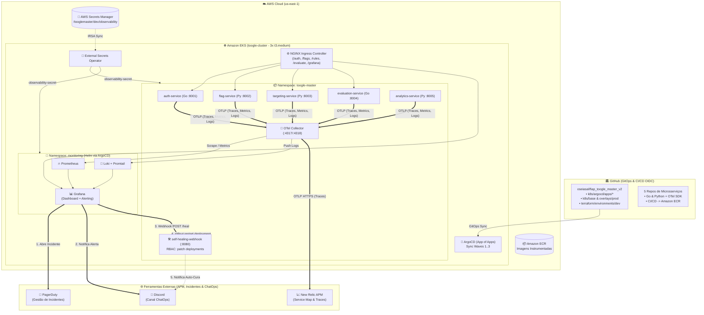

# 📋 SPEC.md: Especificação Técnica — Observabilidade Total, OpenTelemetry, APM & Self-Healing (Fase 4)

> **Projeto:** ToogleMaster (FIAP POS TECH - Tech Challenge Fase 4)  
> **Diretório Oficial:** `C:\Users\oseia\OneDrive\Área de Trabalho\FIAP_MODULO_3`  
> **Repositórios Alvo:** `oseiasal/fiap_toogle_master_v2`, `oseiasal/.github` e os 5 repositórios de microsserviços (`auth-service`, `flag-service`, `targeting-service`, `evaluation-service`, `analytics-service`)  
> **Data de Atualização:** 18/10/2026  
> **Status:** 📝 Especificação Consolidada (Aguardando Aprovação para Implementação)

---

## 🎯 1. Visão Geral & Decisões Arquiteturais

### 1.1 Contexto da Arquitetura Atual (As-Is — Pós-Fase 3)
No diretório oficial [`FIAP_MODULO_3`](file:///C:/Users/oseia/OneDrive/%C3%81rea%20de%20Trabalho/FIAP_MODULO_3), o ecossistema **ToogleMaster** já possui estado da arte em entrega contínua e segurança:
- **IaC Modular (Terraform + Terragrunt):** Rede 3-Tier, EKS (`t3.medium` x86_64 com OIDC/IRSA), 3 RDS PostgreSQL com senhas gerenciadas pela AWS, Redis, DynamoDB, SQS e módulo `secrets_manager` ([terraform/modules/secrets_manager/main.tf](file:///C:/Users/oseia/OneDrive/%C3%81rea%20de%20Trabalho/FIAP_MODULO_3/fiap_toogle_master_v2/terraform/modules/secrets_manager/main.tf)).
- **Zero Static Keys & Segredos Dinâmicos:** **External Secrets Operator (ESO)** sincronizando `/tooglemaster/dev/*` do AWS Secrets Manager via IRSA ([k8s/overlays/prod/external-secrets.yaml](file:///C:/Users/oseia/OneDrive/%C3%81rea%20de%20Trabalho/FIAP_MODULO_3/fiap_toogle_master_v2/k8s/overlays/prod/external-secrets.yaml)), populado pelo script [scripts/update_secrets.py](file:///C:/Users/oseia/OneDrive/%C3%81rea%20de%20Trabalho/FIAP_MODULO_3/fiap_toogle_master_v2/scripts/update_secrets.py).
- **GitOps Puro (ArgoCD App of Apps):** `root-app.yaml` gerenciando `k8s/argocd/apps/01-infra.yaml` e `02-db-seed.yaml` com Sync Waves ([k8s/argocd/root-app.yaml](file:///C:/Users/oseia/OneDrive/%C3%81rea%20de%20Trabalho/FIAP_MODULO_3/fiap_toogle_master_v2/k8s/argocd/root-app.yaml)).
- **Pipelines CI/CD & DevSecOps Centralizadas:** Workflows reutilizáveis em `oseiasal/.github` com testes, linters, SAST (Gosec/Bandit), SCA (Trivy) e push OIDC para o Amazon ECR (`665303623973.dkr.ecr.us-east-1.amazonaws.com`).

### 1.2 Decisões Arquiteturais da Fase 4 (To-Be)
1. **Padronização OpenTelemetry (OTel Collector como Hub Central):**
   - Os 5 microsserviços serão instrumentados com SDKs oficiais do **OpenTelemetry** (Go e Python), exportando **Traces, Métricas e Logs** via protocolo **OTLP (`http/protobuf` na porta `4318` / `grpc` na `4317`)** para o **OTel Collector** no cluster.
   - O **OTel Collector** processa (batch, resource attributes, memory limiter) e roteia:
     - **Métricas** -> **Prometheus** (endpoint `/metrics` + Remote Write);
     - **Logs** -> **Loki** (endpoint push do Loki);
     - **Traces & Métricas APM** -> **New Relic** via OTLP nativo (`https://otlp.nr-data.net`).
2. **Provisionamento GitOps de Observabilidade (ArgoCD App of Apps + Helm Charts):**
   - Seguindo o requisito do edital (*"adicionando os Helm charts ao seu repositório GitOps"*), adicionaremos novas `Applications` do ArgoCD em `k8s/argocd/apps/` (com Sync Waves ordenadas) para provisionar os Helm Charts oficiais do **Prometheus**, **Loki (+ Promtail)**, **Grafana** e **OpenTelemetry Collector**.
3. **Exposição do Grafana e Dashboard Customizado:**
   - Exposto através do **NGINX Ingress Controller** já existente na rota `/grafana` ([k8s/base/ingress.yaml](file:///C:/Users/oseia/OneDrive/%C3%81rea%20de%20Trabalho/FIAP_MODULO_3/fiap_toogle_master_v2/k8s/base/ingress.yaml)) + suporte a `kubectl port-forward`.
   - **Dashboard Customizado (`ToogleMaster - Ecosystem Health`)** provisionado como código via ConfigMap (`grafana_dashboard: "1"`), exibindo saúde de recursos do cluster (CPU/Memória/Pods), taxa de requisições (RPS), latência/erros HTTP 5xx dos microsserviços e painel de logs do Loki em tempo real.
4. **APM Comercial — New Relic (Distributed Tracing & Service Map):**
   - Ingestão OTLP nativa sem agentes proprietários nos nós.
   - Propagação completa de contexto W3C (`traceparent`) nas chamadas HTTP (`evaluation-service` -> `flag-service` / `targeting-service` -> `auth-service`) **e** nos atributos da mensagem SQS (`evaluation-service` -> `analytics-service`), garantindo que **todos os 5 microsserviços** apareçam conectados no **Service Map** do New Relic.
5. **Gestão deSegredos de Observabilidade via AWS Secrets Manager + ESO:**
   - Novo segredo `/tooglemaster/dev/observability` criado no módulo Terraform `secrets_manager` ([terraform/modules/secrets_manager/main.tf](file:///C:/Users/oseia/OneDrive/%C3%81rea%20de%20Trabalho/FIAP_MODULO_3/fiap_toogle_master_v2/terraform/modules/secrets_manager/main.tf)) e sincronizado pelo ESO para armazenar `NEW_RELIC_LICENSE_KEY`, `PAGERDUTY_INTEGRATION_KEY` e `DISCORD_WEBHOOK_URL` sem expor chaves sensíveis no Git.
6. **Alertas Inteligentes, PagerDuty, Discord ChatOps & Self-Healing:**
   - Regra de alerta provisionada no Grafana (`HighErrorRate_5xx > 5%`).
   - Ao disparar (`Firing`), aciona simultaneamente:
     1. **PagerDuty** (Events API v2) -> abre incidente automaticamente;
     2. **Discord** (Webhook) -> publica card detalhado de ChatOps;
     3. **Self-Healing Webhook In-Cluster** (`self-healing-webhook` no namespace `toogle-master` com `ServiceAccount` + `Role`/`RoleBinding` RBAC) -> executa `kubectl rollout restart deployment/<service>` automaticamente e envia confirmação da mitigação no Discord.
   - Workflow complementar `.github/workflows/self-healing.yml` (`repository_dispatch`) documentado no repositório.

---

## 🏛️ 2. Topologia da Arquitetura & Fluxos (Mermaid)

### 2.1 Arquitetura GitOps, Observabilidade & Self-Healing no EKS

---

## 🛠️ 3. Especificação Técnica Detalhada

### 3.1 Infraestrutura & Segredos (`FIAP_MODULO_3/fiap_toogle_master_v2/terraform/`)
1. **Dimensionamento do EKS ([terraform/environments/dev/terragrunt.hcl](file:///C:/Users/oseia/OneDrive/%C3%81rea%20de%20Trabalho/FIAP_MODULO_3/fiap_toogle_master_v2/terraform/environments/dev/terragrunt.hcl)):**
   - Atualizar `eks_desired_size = 3` e `eks_max_size = 4` (mantendo `t3.medium` x86_64) para comportar os pods adicionais do Prometheus, Loki, Promtail, Grafana, OTel Collector e Self-Healing Webhook com folga de CPU/Memória e ENI IP capacity (até 51 pods).
2. **Segredo de Observabilidade ([terraform/modules/secrets_manager/main.tf](file:///C:/Users/oseia/OneDrive/%C3%81rea%20de%20Trabalho/FIAP_MODULO_3/fiap_toogle_master_v2/terraform/modules/secrets_manager/main.tf)):**
   - Criar `aws_secretsmanager_secret.observability` com nome `/tooglemaster/${var.environment}/observability` e incluí-lo na policy IAM `external_secrets_access`.
   - Atualizar [scripts/update_secrets.py](file:///C:/Users/oseia/OneDrive/%C3%81rea%20de%20Trabalho/FIAP_MODULO_3/fiap_toogle_master_v2/scripts/update_secrets.py) para ler `NEW_RELIC_LICENSE_KEY`, `PAGERDUTY_INTEGRATION_KEY` e `DISCORD_WEBHOOK_URL` de variáveis de ambiente ou `.env.observability` local e gravar no Secrets Manager.

### 3.2 Instrumentação dos 5 Microsserviços (`FIAP_MODULO_3/*-service`)

| Microsserviço | Linguagem | Diretório Oficial | Alterações de Código & Dockerfile |
| :--- | :---: | :--- | :--- |
| **`auth-service`** | Go 1.21 | [`FIAP_MODULO_3/auth-service`](file:///C:/Users/oseia/OneDrive/%C3%81rea%20de%20Trabalho/FIAP_MODULO_3/auth-service) | • Novo arquivo `telemetry.go` inicializando OTel TracerProvider e MeterProvider via OTLP HTTP. • Middleware `otelhttp.NewHandler` + métricas de requisições HTTP (total e status 5xx). • Endpoint `POST /chaos/fail` (`?enable=true/false`) que força retorno `HTTP 500` em `/validate` e `/health` (ou apenas nas rotas de negócio) para a demonstração de incidente e Self-Healing. |
| **`evaluation-service`** | Go 1.21 | [`FIAP_MODULO_3/evaluation-service`](file:///C:/Users/oseia/OneDrive/%C3%81rea%20de%20Trabalho/FIAP_MODULO_3/evaluation-service) | • Novo arquivo `telemetry.go` (OTel Tracer + Meter + W3C TraceContext/Baggage Propagator). • `HttpClient` com `otelhttp.NewTransport` e propagação de `ctx` (`r.Context()`) em `getDecision`, `getCombinedFlagInfo`, `fetchFromServices`, `fetchFlag` e `fetchRule`. • Spans explícitos para Redis (`redis.get`, `redis.set`) e SQS (`sqs.send`), injetando `traceparent` nos `MessageAttributes` do SQS. • Endpoint `POST /chaos/fail` para simulação de falhas HTTP 500 em `/evaluate`. |
| **`flag-service`** | Python 3.11 | [`FIAP_MODULO_3/flag-service`](file:///C:/Users/oseia/OneDrive/%C3%81rea%20de%20Trabalho/FIAP_MODULO_3/flag-service) | • Adicionar `opentelemetry-sdk`, `opentelemetry-exporter-otlp`, `opentelemetry-instrumentation-flask`, `requests`, `psycopg2`, `logging` no `requirements.txt`. • Inicialização OTel no `app.py` (com fallback seguro quando `OTEL_SDK_DISABLED=true` nos testes unitários `pytest`). |
| **`targeting-service`** | Python 3.11 | [`FIAP_MODULO_3/targeting-service`](file:///C:/Users/oseia/OneDrive/%C3%81rea%20de%20Trabalho/FIAP_MODULO_3/targeting-service) | • Mesma instrumentação OTel Python (`Flask`, `requests`, `psycopg2`, `logging`) no `requirements.txt` e `app.py`. |
| **`analytics-service`** | Python 3.11 | [`FIAP_MODULO_3/analytics-service`](file:///C:/Users/oseia/OneDrive/%C3%81rea%20de%20Trabalho/FIAP_MODULO_3/analytics-service) | • Adicionar pacotes OTel Python + `opentelemetry-instrumentation-botocore` no `requirements.txt`. • No `sqs_worker_loop`, solicitar `MessageAttributeNames=['All']`, extrair o `traceparent` com `TraceContextTextMapPropagator().extract(...)` e iniciar span `sqs.process` (`SpanKind.CONSUMER`), conectando `evaluation-service -> analytics-service` no Service Map do New Relic. |

> [!TIP]
> **Compatibilidade com Testes Unitários (CI):** Em todos os 5 microsserviços, a exportação OTLP só será ativada se `OTEL_EXPORTER_OTLP_ENDPOINT` estiver definida (ou será desativada em `conftest.py` / `go test`), garantindo que `make test` e `make lint` nas pipelines de CI continuem passando em 100% sem precisar de um OTel Collector rodando durante o `pytest`/`go test`.

### 3.3 GitOps: ArgoCD App of Apps, Helm Charts & Kustomize (`FIAP_MODULO_3/fiap_toogle_master_v2/k8s/`)

1. **Novas Applications do ArgoCD (`k8s/argocd/apps/`):**
   - `03-prometheus-stack.yaml`: Instala os Helm Charts de **Prometheus** e **Grafana** (ou `kube-prometheus-stack` enxuto) no namespace `monitoring` (ou `toogle-master`) com Sync Wave `"2"`.
   - `04-loki-stack.yaml`: Instala o Helm Chart `grafana/loki-stack` (Loki + Promtail para logs de todos os contêineres do cluster) com Sync Wave `"2"`.
   - `05-otel-collector.yaml`: Implanta o **OpenTelemetry Collector** (Helm Chart `open-telemetry/opentelemetry-collector` ou manifesto declarativo) configurado para receber OTLP dos 5 microsserviços e exportar para Prometheus, Loki e New Relic.
2. **Manifestos Base & Prod Overlay (`k8s/base/` e `k8s/overlays/prod/`):**
   - Atualizar ConfigMaps e Deployments dos 5 serviços em `k8s/base/*-service.yaml` adicionando:
     - `OTEL_EXPORTER_OTLP_ENDPOINT: "http://otel-collector.toogle-master.svc.cluster.local:4318"`
     - `OTEL_SERVICE_NAME: "<nome-do-servico>"`
   - Adicionar `k8s/base/otel-collector.yaml` e `k8s/base/observability-dashboard-alerts.yaml` (contendo o **Dashboard Customizado do Grafana** e as **Regras de Alerta + Contact Points** para PagerDuty, Discord e Self-Healing).
   - Adicionar `k8s/base/self-healing-webhook.yaml` (Deployment + Service + ServiceAccount + Role + RoleBinding que executa `kubectl rollout restart deployment/<service> -n toogle-master` ao receber o webhook de alerta).
   - Atualizar `k8s/base/ingress.yaml` para expor `/grafana` no NGINX Ingress Controller.
   - Atualizar `k8s/overlays/prod/external-secrets.yaml` com `observability-external-secret` puxando `/tooglemaster/dev/observability`.

---

## ✅ 4. Critérios de Aceite (Definition of Done - DoD)

1. **CI/CD & DevSecOps Intactos:** Os 5 repositórios de microsserviços passam em `make test` e `make lint` localmente e nas pipelines do GitHub Actions.
2. **Stack Opensource no EKS via GitOps:** ArgoCD sincronizado com Prometheus, Loki, Grafana, OTel Collector e os 5 microsserviços; Dashboard customizado acessível via Ingress (`/grafana`) ou `port-forward` mostrando uso de recursos do cluster, RPS, erros 5xx e logs do Loki em tempo real.
3. **APM New Relic:** Service Map exibindo os 5 microsserviços e Distributed Tracing mostrando o caminho completo da requisição em `/evaluate`.
4. **Incidente, ChatOps & Self-Healing:** Ao acionar `POST /chaos/fail?enable=true`, o alerta dispara no Grafana, abre incidente no PagerDuty, envia notificação no Discord e aciona o `self-healing-webhook` que executa `kubectl rollout restart` automaticamente, restaurando o serviço.
5. **Relatório Técnico & Roteiro de Vídeo:** Documento `RELATORIO_FASE_4.md` completo com espaço para os 4 prints obrigatórios e a Justificativa Técnica detalhada.
